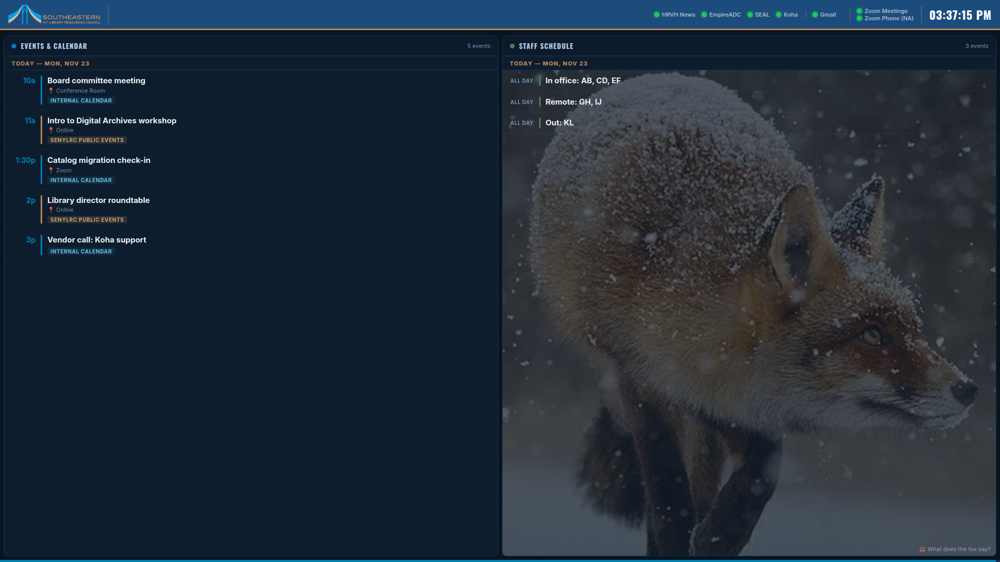
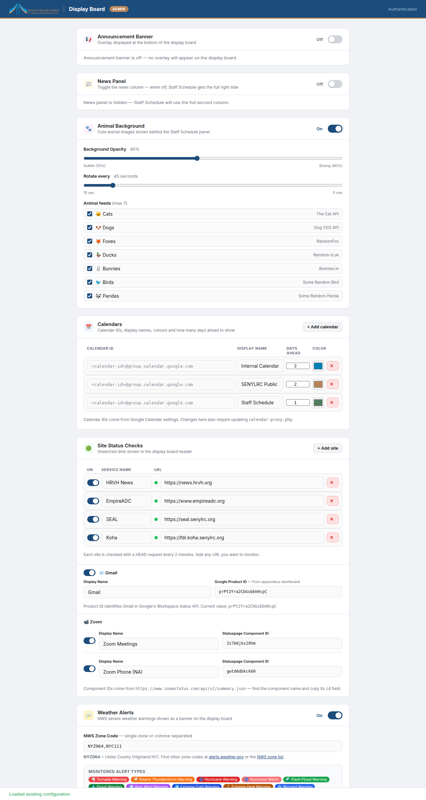

# SENYLRC TV Display Board

Kiosk display for the Southeastern NY Library Resources Council: calendars, staff schedule, service status (sites, Gmail, Zoom), NWS weather alerts, optional news/announcements, and a rotating animal background. Plain HTML/JS + small PHP proxies; configured through `admin.htm`.

## Screenshots

Sample data shown (no real staff or event information).

- **Full documentation:** [docs/SYSTEM.md](docs/SYSTEM.md)
- **Setup:** copy files to a PHP web root, set `SENYTV_PRIVATE_DIR` (a directory **outside** the web root, via `SetEnv` in Apache) and put `service-account.json` (Google service account) and `config.local.php` (copy from `config.local.php.example`; sets the admin password and the TV's `DISPLAY_TOKEN`) in it, and copy `board-config.example.json` to `board-config.json`. None of these is in git. Open `index.htm#key=<DISPLAY_TOKEN>` once on each TV.
- **Display:** `index.htm`  **Admin:** `admin.htm`

## License

MIT — see [LICENSE](LICENSE).
